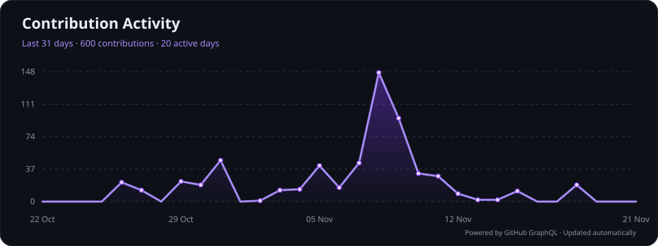

## 👋 About me

I'm **Vikas**, a builder working on AI-powered applications, full-stack systems, developer tooling, and immersive computing. I like taking ideas from a prototype to something people can actually try.

- 🤖 Interested in **AI agents, machine learning, LLM applications, and safe automation**
- 🥽 Exploring **augmented reality and spatial learning**
- 🛠️ Building **web products, APIs, and developer tools**
- 🚀 Turning hackathon ideas into working demonstrations

## 🧰 Technologies I've worked with

## 📄 Resume

Interested in my education, experience, selected projects, technical skills, and hackathon achievements? **[View my resume](RESUME.md)** or **[download the PDF](https://raw.githubusercontent.com/vikassharma270907-alt/vikassharma270907-alt/output/Vikas_Sharma_Resume.pdf)**. The PDF is regenerated from the resume page automatically by [GitHub Actions](.github/workflows/snake.yml).

## 🚀 Selected projects

<table>
<tr>
<td width="50%" valign="top">
<h3>🎓 <a href="https://github.com/vikassharma270907-alt/campusbuddy-uxdc">CampusBuddy</a></h3>

A campus micro-connection experience for helping students find low-pressure, meaningful connections.

<a href="https://campusbuddy-uxdc.vercel.app"><strong>Live demo</strong></a> · <a href="https://github.com/vikassharma270907-alt/campusbuddy-uxdc"><strong>Source</strong></a>

</td>
<td width="50%" valign="top">
<h3>🥽 <a href="https://github.com/vikassharma270907-alt/loci-lens">TorqueLock AR</a></h3>

An AR spatial-learning and procedural training coach designed around Snap SPECS and Lens Studio.

<a href="https://loci-lens.vercel.app"><strong>Simulator</strong></a> · <a href="https://github.com/vikassharma270907-alt/loci-lens"><strong>Source</strong></a>

</td>
</tr>
<tr>
<td width="50%" valign="top">
<h3>🛡️ <a href="https://github.com/vikassharma270907-alt/airlock-guardrails">Airlock</a></h3>

Deterministic guardrails and approval boundaries for autonomous AI coding workflows.

<a href="https://airlock-guardrails.vercel.app/#playground"><strong>Live playground</strong></a> · <a href="https://github.com/vikassharma270907-alt/airlock-guardrails"><strong>Source</strong></a>

</td>
<td width="50%" valign="top">
<h3>🌿 <a href="https://github.com/vikassharma270907-alt/EthnoKG">EthnoKG</a></h3>

Connects traditional knowledge with traceable scientific evidence through a knowledge-graph workflow.

<a href="https://ethnokg-platform.onrender.com"><strong>Live demo</strong></a> · <a href="https://github.com/vikassharma270907-alt/EthnoKG"><strong>Source</strong></a>

</td>
</tr>
<tr>
<td width="50%" valign="top">
<h3>💳 <a href="https://github.com/vikassharma270907-alt/flowguard-treasury">BeyondFlow</a></h3>

An AI-agent treasury workflow with governed tool calls and approval controls.

<a href="https://flowguard-treasury.vercel.app"><strong>Live demo</strong></a> · <a href="https://github.com/vikassharma270907-alt/flowguard-treasury"><strong>Source</strong></a>

</td>
<td width="50%" valign="top">
<h3>🪐 <a href="https://github.com/vikassharma270907-alt/solar-system-3D-visualisation">Solaris</a></h3>

An interactive 3D solar system explorer with procedural planet visuals and orbital controls.

<a href="https://github.com/vikassharma270907-alt/solar-system-3D-visualisation"><strong>Source</strong></a>

</td>
</tr>
</table>

## 📊 GitHub at a glance

## 📈 Contribution activity

*This graph is generated from GitHub contribution data by [my GitHub Actions workflow](.github/workflows/snake.yml), without relying on a third-party graph server.*

## 🐍 Contribution snake

*The light and dark snake SVGs are generated by [GitHub Actions](.github/workflows/snake.yml) and published to the `output` branch.*

## 🤝 Connect

[-7C3AED?style=for-the-badge&logo=x&logoColor=white)](https://x.com/VikasSharm90791)

**Email:** [vikas.sharma975357@gmail.com](mailto:vikas.sharma975357@gmail.com)

---

~~~bash
$ whoami
Vikas — AI + full-stack builder

$ interests
AI agents · ML · AR · practical products

$ status
Learning. Building. Improving.
~~~

